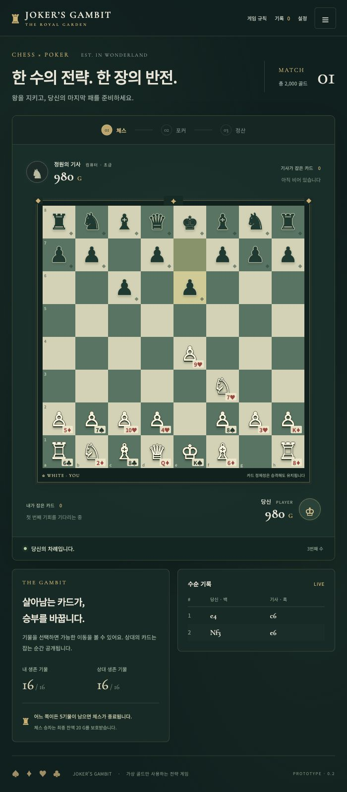

> 이름·도메인 표기와 캠페인의 임시 범위: [브랜드 및 확장 메모](docs/24_BRAND_AND_SCOPE.md)

> **최신 설계:** [정산 R3](docs/21_ECONOMY_CORRECTION.md) · [게임/엔딩 흐름](docs/22_CAMPAIGN_FLOW.md) · [오류·변경 대장](docs/CHANGE_REGISTER.md). 이전15/25 설명은 폐기. 런타임 이행 전입니다.

> **구현 상태:** 실행 프로토타입은 결정적 체스 30G/포커 10G를 사용합니다. R3의 체스 무승부 이월 및 캠페인·엔딩 흐름은 아직 구현 전입니다. 문서20의 전체15/25 계산은 폐기했습니다.

# 현행 규칙과 요구 대조

[현재 규칙](docs/CURRENT_RULES.md) · [요구 재점검/미완료 항목](docs/19_REQUIREMENTS_AUDIT.md)

# Joker’s Mate · The Royal Garden

체스의 한 수, 포커의 한 장. **플레이 가능한 브라우저 2D 프로토타입 v0.2**입니다.

표준 체스 → 생존 카드 5장 선택 → 베팅 → 최종 정산 → 다음 판까지 구현했습니다. 상대는 브라우저에 포함된 **내장 컴퓨터 로직**입니다. OpenAI·ChatGPT 등 외부 AI 서비스, API 키, 계정 연결은 필요하지 않습니다.



## 실행

Node.js 22.12 이상이 필요합니다(검증: 22.22.2).

```sh
npm ci
npm run build
npm run play
```

브라우저에서 [게임 열기](http://127.0.0.1:5173/)를 선택합니다. `play`는 터미널 작업과 분리된 로컬 서버를 시작합니다. 이미 실행 중이면 중복 실행하지 않습니다. 종료는 `npm run stop`입니다. 다른 프로그램이 5173을 사용하면 종료하거나 `JOKERS_PORT`로 별도 포트를 선택하세요. 포트가 달라지면 브라우저 저장 영역도 달라집니다.

macOS에서는 [START_GAME.command](START_GAME.command)를 실행해 설치 확인·빌드·시작을 한 번에 할 수 있습니다. Node가 설치되어 있어야 하며 최초 의존성 설치에는 네트워크가 필요합니다. 로컬 서버는 127.0.0.1에만 열립니다. 인터넷 공개 배포는 하지 않았습니다.

개발은 `npm run dev`, 검증은 `npm test`, 배포 파일 생성은 `npm run build`입니다. `dist/`와 `node_modules/`는 Git에 포함하지 않습니다.

## 구현된 흐름

- 54장 중 고유 32장 배정. 초기 킹은 서로 다른 K, 퀸은 서로 다른 Q. 이동·캡처·캐슬링·앙파상·승격에서 정체성 유지.
- chess.js 기반 합법 이동, 체크 방어, 승격 선택, 체크메이트, 5기물 종료 특례, 반복·50수 무승부.
- 생존 카드 중 5장 선택 및 최적 패 추천. 조커 0~2장, A-low, 랭크·무늬 비교.
- 체크·베트·콜·레이즈·폴드·올인. 불균등 스택, 짧은 올인, 미대응 금액 반환.
- 총 2000골드 보존. 새 판은 체스15G·포커5G 분리, 최종20G 보호 폐지. 정산 후20 미만이면 다음 판 참가 불가. [현행 경제](docs/18_APPROVED_ECONOMY.md).
- 초급 컴퓨터의 2-ply 탐색, 자기 카드 보존 평가, 자기 패만 사용하는 베팅. 상대 숨은 카드 입력 없음.
- 반응형 정원 테이블, 공개 캡처함, 금고, 카드 테이블, 간단한 마차·깃발 연출, 이동 표시와 모션 설정.
- 진행 자동 저장/복구, 최근 100판 결과·PGN·공개 카드·정산 내역·업적, JSON 내보내기.

## 적용 규칙과 문서

기존 Phase 1의 승인/미승인 기록을 지우지 않았습니다. 사용자에게 권장안을 제시한 후 “게임 구현까지 해줘”라는 지시에 따라 0.2에서 적용한 규칙과, 구현 중 선택한 조정 가능한 기본값은 [15_PROTOTYPE_DECISIONS](docs/15_PROTOTYPE_DECISIONS.md)에 구분했습니다.

- [01 비전](docs/01_GAME_VISION.md) · [02 통합 규칙](docs/02_GAME_RULES.md) · [03 카드](docs/03_CARD_SYSTEM.md)
- [04 체스](docs/04_CHESS_SYSTEM.md) · [05 포커](docs/05_POKER_SYSTEM.md) · [06 경제](docs/06_ECONOMY_SYSTEM.md)
- [07 컴퓨터 상대](docs/07_AI_DESIGN.md) · [08 흐름](docs/08_GAME_FLOW.md) · [09 화면](docs/09_UI_UX_SPEC.md)
- [10 업적](docs/10_ACHIEVEMENTS.md) · [11 데이터](docs/11_DATA_MODEL.md) · [12 기술 구조](docs/12_TECH_ARCHITECTURE.md)
- [13 미술](docs/13_ART_DIRECTION.md) · [14 로드맵](docs/14_ROADMAP.md)
- [남은 결정](docs/OPEN_QUESTIONS.md) · [결정 기록](docs/DECISION_LOG.md) · [검증 결과](docs/16_VALIDATION.md)

## 현재 한계

정식 출시본이 아닙니다. 난도 3/10은 목표 수준이며 Elo 검증치는 아닙니다. 오프닝 업적은 세 가지 정확한 초반 수순만 인식합니다. FIDE의 청구형/자동형 무승부를 완전 재현하지 않고 3회 반복·50수를 자동 처리합니다. 기권·합의 무승부·온라인 대전·Steam 통합·최종 캐릭터 아트는 아직 없습니다.

진행 저장에는 이어하기를 위한 전체 카드 배정이 로컬에 들어 있습니다. 화면·컴퓨터 입력·공개 기록은 숨은 카드를 제한하지만, 브라우저 개발자 도구를 이용한 치트 방지까지 제공하지 않습니다. 저장은 브라우저/주소별이며 클라우드 동기화가 없습니다. Google Fonts를 불러오지 못하면 시스템 서체로 표시하고, 게임 연산은 네트워크를 사용하지 않습니다.

## 첫 수 이후 멈춤 수정

이전 개발 미리보기는 컴퓨터 차례가 되면 별도 Worker 파일을 불러왔습니다. 서버가 끊어진 채 화면만 남으면 파일을 로드하지 못하고 멈췄습니다. 0.2에서는 상대 로직을 초기 게임 번들에 포함하고 Worker 의존성을 제거했습니다. 포커 조합 계산은 화면이 응답할 수 있도록 나누어 실행합니다. 오래된 화면이라면 새로고침하면 저장된 판을 이어갑니다.

저장소: [kkaengEminE/jokers-mate](https://github.com/kkaengEminE/jokers-mate) · 비공개
